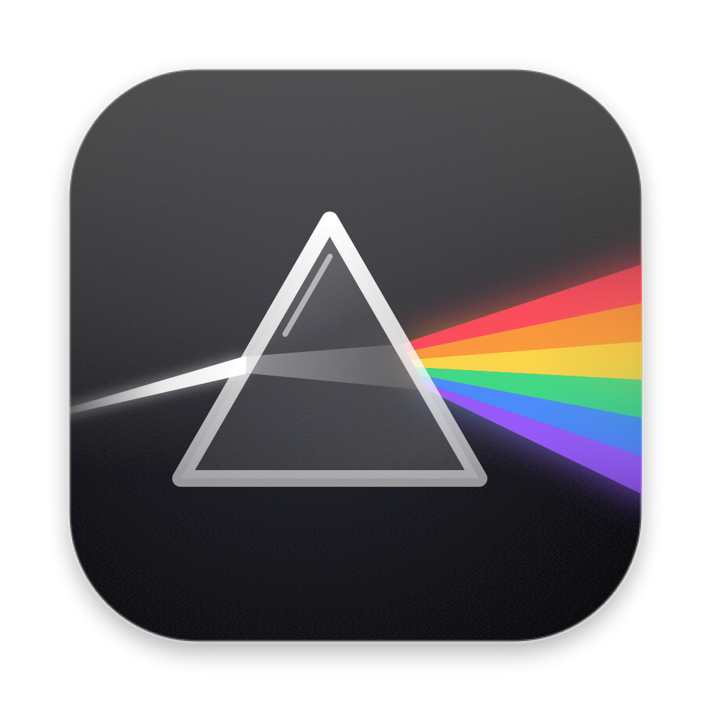

<p align="center">
  
</p>

<h1 align="center">Spectra</h1>

<p align="center">一个快捷键，在任何地方找到应用、文件和文件里的内容。</p>

---

Spectra 是一个 macOS 菜单栏应用。按下快捷键，屏幕上浮出一个搜索面板：输入几个字，应用、文件名、文件内容、计算结果一起出现，回车直接打开。

名字和图标来自棱镜：一束光进去，分成一道光谱。一次输入，得到多种结果。

## 功能

- **应用**：按名字模糊匹配，`vsc` 能找到 Visual Studio Code
- **文件**：基于系统的 Spotlight 索引，按文件名搜索用户目录，几十毫秒出结果
- **文件内容**：搜到正文里包含关键词的 PDF、文稿、笔记、代码
- **计算器**：直接输入 `(1280-96)*0.8`，回车把结果拷贝到剪贴板
- **网页搜索**：没找到时一键交给 Google / Bing / 百度 / DuckDuckGo
- **预览**：选中文件时右侧显示缩略图、类型、页数或尺寸、大小、修改时间
- **操作菜单**：`⌘K` 对选中项执行更多操作：在 Finder 中显示、拷贝路径或文件、在终端中打开、移到废纸篓
- **越用越准**：通过 Spectra 打开得越多、越近的项目，排得越靠前
- **轻量**：安装后约 11 MB，后台常驻内存约 50 MB；没有 Dock 图标，只在菜单栏

所有搜索都在本机完成，不上传任何数据。

## 快捷键

| 按键 | 作用 |
|---|---|
| `⌥ Space` | 唤起 / 隐藏面板（被占用时自动改用 `⌥⇧Space` 或 `⌘⌥Space`，可在设置里更换） |
| `↑` `↓` / `⌃N` `⌃P` | 上下选择 |
| `↵` | 打开选中项 |
| `⌘ ↵` | 在 Finder 中显示 |
| `⌘ K` | 操作菜单 |
| `Tab` / `⇧ Tab` | 切换分类：全部、应用、文件、文件夹、文档、图片 |
| `⌘ 1` … `⌘ 9` | 直接打开第 N 个结果 |
| `⌘ ⇧ C` | 拷贝路径 |
| `⌘ ⌥ C` | 拷贝文件 |
| `⌘ T` | 在终端中打开所在文件夹 |
| `Esc` | 关闭菜单 → 清空输入 → 隐藏面板 |
| `⌘ ,` | 设置 |

## 安装

需要 macOS 12 或更高版本，目前提供 Apple 芯片（arm64）版本。

从源码构建：

```bash
git clone https://github.com/BubbleBrainBB/BB-Spectra-launch.git
cd BB-Spectra-launch
go tool mygo build
cp -R build/darwin-arm64/Spectra.app /Applications/
```

构建结果在 `build/darwin-arm64/`，包括 `Spectra.app` 和安装包 `.dmg`。

目前应用使用本机自签名，没有 Apple 开发者证书。在其他电脑上第一次打开时，系统会阻止运行，需要右键点击应用，选择“打开”。

## 开发

需要 [Go](https://go.dev) 1.27 或更高版本。界面使用 [MyGo](https://github.com/egoist/mygo) 的原生 UI，由 GPU 绘制，整个应用是一个纯 Go 程序。

```bash
go tool mygo dev                    # 运行开发版，改代码自动重新编译
CGO_ENABLED=0 go test -race ./...   # 测试
go tool mygo vet . && go vet ./...  # 检查
go tool mygo build                  # 打包
```

运行开发版前请先退出已安装的 Spectra，否则会出现两个菜单栏图标。

### 代码结构

| 文件 | 内容 |
|---|---|
| `search.go` | `Provider` 接口、搜索引擎（并行运行各数据源，取消过期查询）、匹配与排序 |
| `providers.go` | 各个数据源：应用、Spotlight（文件名和内容）、计算器、网页搜索 |
| `results.go` | 合并结果、分组（最佳匹配、应用、文件、内容包含……）、选择 |
| `view.go` | 搜索面板界面 |
| `actions.go` | `⌘K` 操作 |
| `preview.go` | 右侧预览（`mdls` 元数据 + Quick Look 缩略图） |
| `settings.go` | 设置窗口 |
| `store.go` | 使用记录和设置，保存为用户数据目录里的 JSON |
| `trayicon.go` | 菜单栏图标 |
| `design/` | 界面设计稿和图标方案 |

每种搜索来源都是一个 `Provider`：

```go
type Provider interface {
	ID() string
	Delay() time.Duration // 0：输入时立即在界面线程运行；否则停顿后在后台运行
	Search(ctx context.Context, q Query) ([]Result, error)
}
```

新增搜索能力只需要实现一个新的 `Provider`，不用改动现有代码。

## 路线图

- [ ] 图片语义搜索：用本地多模态模型理解图片内容，输入“海边日落”找到对应照片
- [ ] 图片文字识别：搜到截图、照片里的文字
- [ ] 视频画面搜索：找到视频里的某一帧，打开后直接跳到那个时间点
- [ ] 按空格快速查看
- [ ] 拼音搜索
- [ ] “打开方式…”
